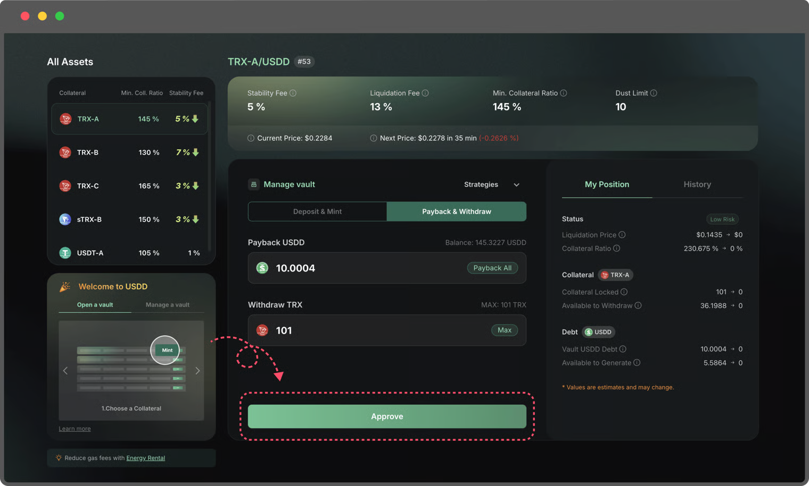
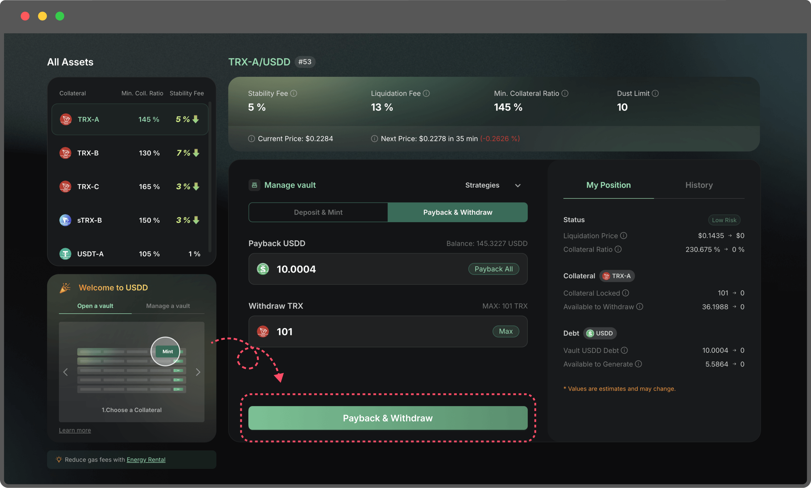

# Close a Vault

**Guide Scope: TRON**\
This guide covers repaying the full debt and withdrawing all collateral from a Vault on TRON. The instructions and screenshots below apply to TRON.

1. **Navigate to the Vault page**

Go to the Vault section and locate the active [Vault](https://app.usdd.io/tron/) you wish to close.

2. **Connect Your Wallet**

Connect your wallet to the platform.&#x20;

Ensure your wallet has enough TRX to cover the gas fees required for repayment and collateral withdrawal.

<figure><figcaption></figcaption></figure>

3. **Review Your Vault Status**

Before closing your Vault, check:

* The outstanding USDD debt
* Your collateral balance
* Your current collateral ratio

Make sure you have enough USDD in your wallet to fully repay the debt.

<figure><figcaption></figcaption></figure>

4. **Repay all borrowed USDD**

Navigate to the Payback & Withdraw tab

<figure><figcaption></figcaption></figure>

In the Payback field, click Payback All or enter the full debt amount.

<figure><figcaption></figcaption></figure>

5. **Withdraw all your collateral**

In the Withdraw field, click Max or enter the full collateral amount.

<figure><figcaption></figcaption></figure>

6. **Approve USDD spending, if required**

If an **Approve** button is displayed, click it and confirm the approval in your wallet. Wait for the approval to complete before proceeding.\
Approval only grants permission to spend USDD. It does not repay your debt or withdraw your collateral.

<figure><figcaption></figcaption></figure>

7. **Confirm repayment and collateral withdrawal**

Review the full repayment amount and the collateral amount to withdraw. Click **Payback & Withdraw**, then confirm the transaction in your wallet. Wait for the transaction to succeed.

<figure><figcaption></figcaption></figure>

Once completed, your Vault debt will be zero, and all collateral will be returned to your wallet.

<figure><figcaption></figcaption></figure>

**Note:**

If you don’t have enough USDD, you can:

* Swap USDD via the PSM (Peg Stability Module)
* Or purchase USDD from exchanges
