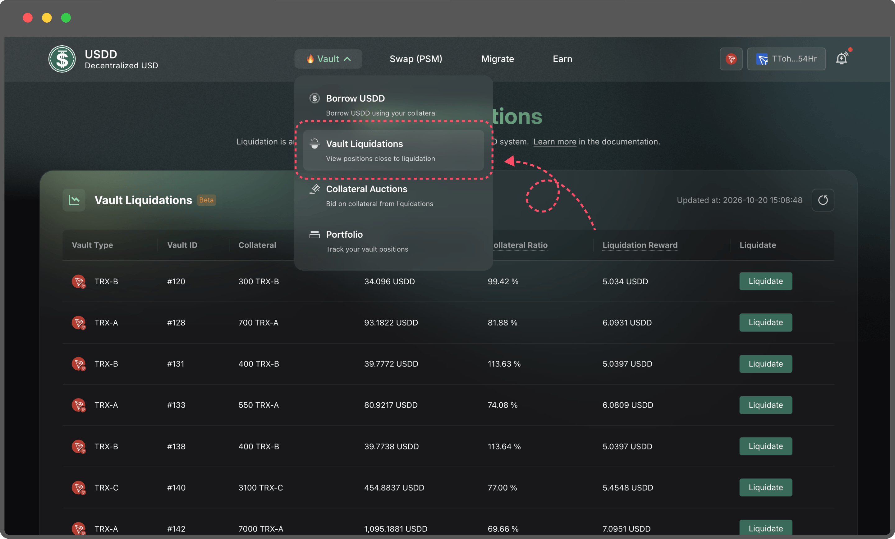
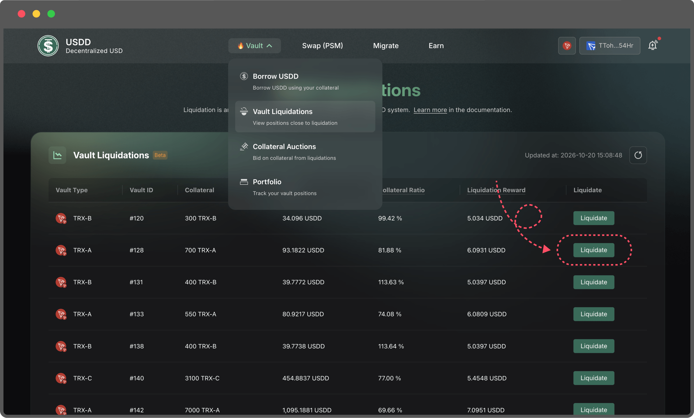
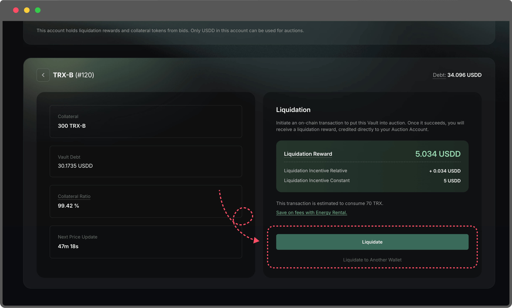

# Liquidation

**Guide Scope: TRON**\
The participation instructions below apply to [Vault liquidations](https://app.usdd.io/tron/liquidation) on TRON.

When a Vault's Collateralization Ratio falls below the Min. Collateral Ratio, it becomes eligible for liquidation. This process plays a critical role in maintaining the stability and efficiency of the USDD ecosystem. By participating in liquidations, users can earn rewards while contributing to the system's health.

#### Steps to Participate in Liquidation

1.  **Navigate to the Liquidation Page**\
    Visit the Liquidation Page to view Vaults eligible for liquidation.

    <figure><figcaption></figcaption></figure>

2.  **Review Vault Details**\
    Each Vault's detailed information, including its debt and collateral status, is available on the liquidation page. This helps users make informed decisions before initiating a liquidation.

    <figure><figcaption></figcaption></figure>
3. **Earn Liquidation Rewards**\
   Users who trigger a liquidation will receive a reward. Rewards are distributed based on the following formula: **Potential Net Profit = Liquidation Incentive (Relative) + Liquidation Incentive (Constant) - Transaction Fee**
   1. Liquidation Incentive (Relative): This reward component is proportional to the debt of the liquidated Vault.
   2. Liquidation Incentive (Constant): A fixed reward for successfully liquidating a Vault.
   3. **Transaction Fee:** The estimated network fee, expressed in USDD for this calculation. If the fee is shown in TRX, convert it first: **Estimated Fee (USDD) = Estimated Fee (TRX) × TRX Price (USDD per TRX)**. Use the TRX/USDD price at the time of estimation. Do not subtract a TRX amount directly from a USDD reward. Actual fees and net profit may differ from the estimate.

       <figure><figcaption></figcaption></figure>
4. Choose Reward Address:

   Select the address whose Auction Account will receive the liquidation reward. By default, this is your connected wallet address; you may specify another TRON address you control. The reward is credited to that address’s Auction Account, not directly to its wallet token balance.
5. Withdraw Rewards：

   After the liquidation transaction succeeds, connect the wallet for the selected reward address and check its USDD balance in the Auction Account. Use Withdraw to transfer the available USDD to that wallet. Withdrawal is a separate on-chain transaction and requires applicable network fees.

#### Key Benefits

* Helps maintain system stability by resolving under-collateralized Vaults.
* Provides users with tangible incentives for their participation.
